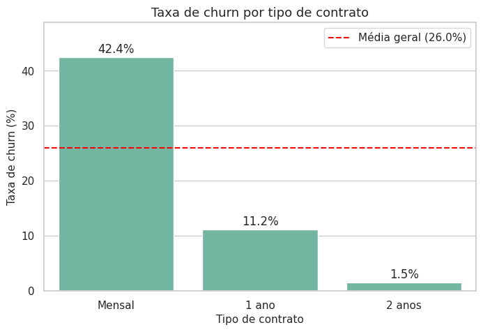

# Churn em Telecom

Projeto do curso **Profissão: Cientista de Dados (EBAC)**, desenvolvido ao longo de vários módulos com a mesma base: 2.495 clientes de uma empresa de telecomunicações e a variável `Churn`, que indica quem cancelou o serviço.

O objetivo final é prever quais clientes ativos têm maior risco de cancelar. Cada pasta corresponde a uma etapa do caminho até o modelo.

**Autor:** Lucas Farias Epitácio de Almeida

## Etapas

| Módulo | Pasta | O que tem |
| --- | --- | --- |
| 14 | [`modulo-14-pre-processamento`](modulo-14-pre-processamento/) | Tratamento da base original: tipos, valores ausentes, grafias inconsistentes e renomeação. Gera o `data_preprocessed.csv` |
| 15 | [`modulo-15-eda`](modulo-15-eda/) | Análise exploratória: univariada, outliers, bivariada, correlação e importância das variáveis |
| 16 | [`modulo-16-tipo-de-aprendizado`](modulo-16-tipo-de-aprendizado/) | Justificativa do tipo de aprendizado: supervisionado, classificação binária |

## Principais achados até aqui

| Achado | Resultado |
| --- | --- |
| Taxa geral de churn | 26% (74/26, alvo desbalanceado) |
| Contrato mensal x 2 anos | 42,4% x 1,5% de churn |
| Primeiro ano como cliente | 45,8% de churn |
| Fibra óptica x DSL | 42,0% x 17,2% de churn |
| Cheque eletrônico | 45,6% de churn (demais formas: 13,5% a 18,1%) |
| Sem suporte técnico x com suporte | 42,0% x 12,6% de churn |
| `Tempo_como_Cliente` x `Total_Pago` | correlação de 0,83; `Total_Pago` sai da base de modelagem |

**Perfil de maior risco:** contrato mensal, primeiro ano de casa, fibra óptica, sem suporte técnico e pagamento por cheque eletrônico.



## Próximos passos

Treinar modelos de classificação com divisão estratificada entre treino e teste, tratar o desbalanceamento só na base de treino e avaliar por recall e F1, já que o custo de deixar passar um cliente que vai cancelar é maior que o de um falso alarme.

## Como executar

```bash
pip install -r requirements.txt
```

Depois, abra os notebooks na ordem dos módulos. Cada um lê os dados da própria pasta `dados/`.

Cada pasta tem seu próprio README com detalhes da etapa.

## Tecnologias

Python · pandas · NumPy · Matplotlib · Seaborn · Plotly
