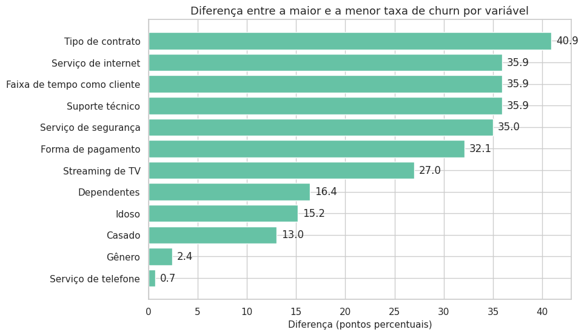
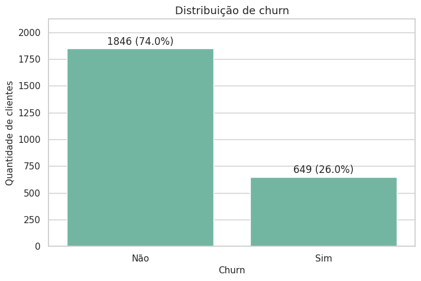
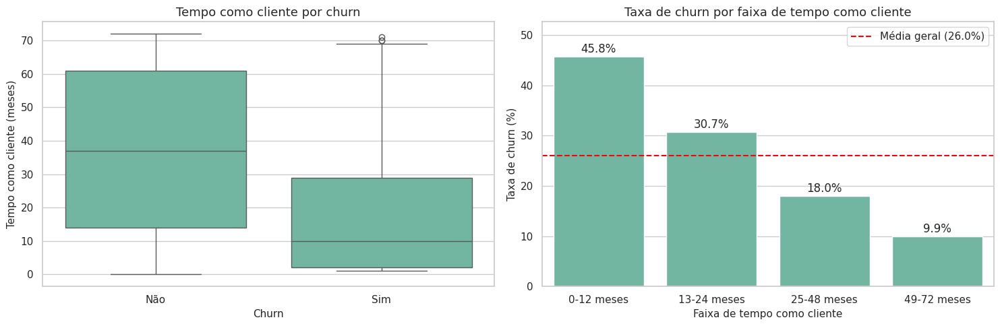

# Módulo 15 – Análise Exploratória de Dados (Churn)

[← Voltar ao projeto](../README.md)

Atividade do curso **Profissão: Cientista de Dados (EBAC)**.
Segunda etapa da pré-modelagem: análise univariada, outliers, balanceamento e análise bivariada da base de churn de uma empresa de telecomunicações, pré-processada no Módulo 14.

**Autor:** Lucas Farias Epitácio de Almeida

## Objetivo

Entender quais características dos clientes estão associadas ao cancelamento do serviço (**Churn**) antes de treinar qualquer modelo, produzindo um insight escrito para cada estatística e gráfico.

## Base de dados

- `dados/data_preprocessed.csv`: base própria tratada no [Módulo 14](../modulo-14-pre-processamento/) (2.495 clientes, 16 colunas, sem valores ausentes).
- `dados/data_modelagem.csv`: base gerada neste módulo para a próxima etapa, sem o identificador e sem `Total_Pago` (redundante com `Tempo_como_Cliente`).

## O que foi feito

1. **Análise univariada:** `describe()` com insights, gráficos de 7 variáveis e verificação do balanceamento das 6 variáveis booleanas.
2. **Outliers:** boxplots e regra do IQR. Nenhuma variável numérica apresentou outliers; os dados foram mantidos, com justificativa.
3. **Análise bivariada:** 8 perguntas de negócio respondidas com gráficos de taxa de churn por categoria e matriz de correlação.
4. **Variáveis correlacionadas:** detecção automática de pares acima de 0,7 e retirada de `Total_Pago` da base de modelagem.
5. **Importância das variáveis:** ranking pela diferença entre a maior e a menor taxa de churn de cada variável.
6. **Resultados salvos:** todas as tabelas consolidadas exportadas para `resultados/` (CSV e Excel).

## Principais resultados

| Achado | Resultado |
| --- | --- |
| Taxa geral de churn | 26% (alvo desbalanceado, 74/26) |
| Contrato mensal x 2 anos | 42,4% x 1,5% de churn |
| Primeiro ano como cliente | 45,8% de churn |
| Fibra óptica | 42,0% de churn (DSL: 17,2%) |
| Cheque eletrônico | 45,6% de churn (demais formas: 13,5% a 18,1%) |
| Sem suporte técnico | 42,0% de churn (com suporte: 12,6%) |
| Tempo como cliente x Total pago | correlação de 0,83 (redundantes) |

**Perfil de maior risco:** contrato mensal, primeiro ano de casa, fibra óptica, sem suporte técnico e pagamento por cheque eletrônico.



<p>
  
  
</p>



## Estrutura da pasta

```
modulo-15-eda/
├── Profissao_Cientista_de_Dados_M15_Pratique.ipynb   # notebook completo, já executado
├── dados/
│   ├── data_preprocessed.csv    # base de entrada (Módulo 14)
│   └── data_modelagem.csv       # base de saída para a modelagem
├── resultados/                  # tabelas consolidadas (CSV + Excel)
├── imagens/                     # gráficos usados neste README
└── README.md
```

## Como executar

**Localmente**

```bash
pip install -r ../requirements.txt
cd modulo-15-eda
jupyter notebook Profissao_Cientista_de_Dados_M15_Pratique.ipynb
```

**No Google Colab:** abra o notebook, crie a pasta `dados/` no painel de arquivos, envie o `data_preprocessed.csv` para ela e execute todas as células.

## Padrões de código

- Gráficos gerados por funções parametrizadas e loops (`plot_contagem`, `plot_histograma`, `plot_taxa_churn`).
- Todas as funções com docstring (parâmetros, retorno e comportamento).
- Títulos, eixos, legendas e categorias em português.
- Critérios em constantes nomeadas (`LIMITE_BALANCEAMENTO`, `LIMITE_CORRELACAO`).

## Tecnologias

Python · pandas · NumPy · Matplotlib · Seaborn
